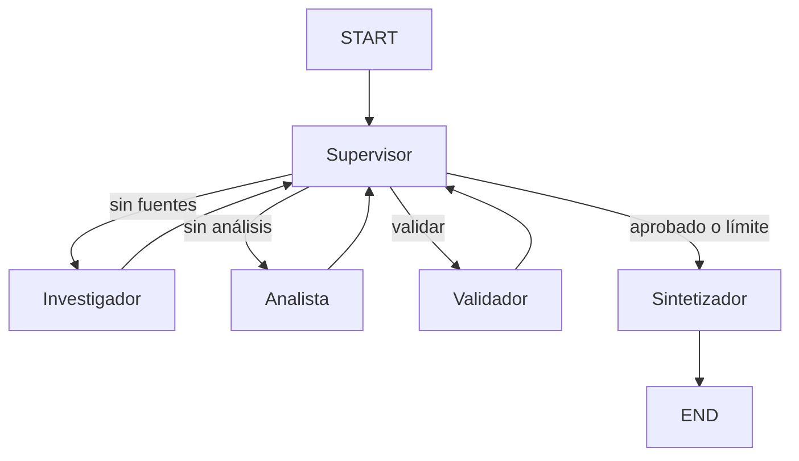

# Orquestador multi-agente de análisis e investigación

Prototipo funcional en LangGraph. El supervisor decide dinámicamente el siguiente nodo: primero investigación, luego análisis, validación y síntesis. El límite `max_steps` evita ciclos infinitos.



## Estructura

```text
state.py                 # Estado compartido basado en MessagesState
agents/research_agent.py # Búsqueda en corpus local mediante tool
agents/analyst_agent.py  # Cálculo de sentimiento mediante tool
graph.py                 # Supervisor, validación y StateGraph
main.py                  # Demo ejecutable
demo.ipynb               # Demo alternativa en notebook
```

## Ejecución

```bash
pip install -r requirements.txt
python main.py
```

## Decisiones de diseño

La topología es jerárquica: solo el supervisor decide la ruta y los especialistas no se invocan entre sí. `research_results`, `analysis`, `validation` y `contributions` preservan la trazabilidad sin exponer metadata innecesaria a cada nodo. El validador usa una rúbrica explícita (fuentes + etiqueta + puntaje); si falla, el supervisor vuelve al investigador. La síntesis solo se alcanza con validación aprobada o al exceder el límite de pasos.
